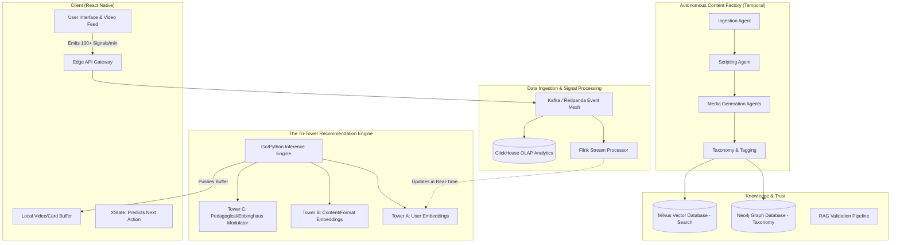

# Shiro: The Final Form Architecture (Phase 10+)

To transform Shiro into the best learning application in the world—a system capable of competing with TikTok's engagement gravity while securely embedding rigorous cognitive science—the architecture must grow beyond a single Node.js/PostgreSQL monolith. 

The system needs to operate on the scale of massive social networks, paired with the determinism of academic software. This requires shifting to an **Event-Driven, Distributed, Multi-Agent Architecture**.

Here is the architectural blueprint for Shiro's ultimate vision.

---

## 1. The Tri-Tower Recommendation Engine (The Brain)
At its core, Shiro is a recommendation engine. Standard social networks match a *User* to a *Content Piece*. Shiro must match a *User's cognitive state* to a *Conceptual Need* and wrap it in the most engaging *Content Format*. 

The recommendation inference pipeline must evaluate in under `50ms`.

* **Tower A: The User State (Embedding)**: Current interests, historical click-through rates, format preferences, and micro-attention models.
* **Tower B: The Content Features (Embedding)**: Visual density, vocabulary complexity, hooked retention metrics, format, duration.
* **Tower C: The Pedagogical State (The Modulator)**: A continuous mathematical model of the user's brain. Uses a modified SM-2 / Ebbinghaus algorithm mapped against a massive Knowledge Graph. If the decay curve for "Gyroscopic Precession" drops below 70%, Tower C overrides Tower A and B to forcefully inject a review card.

**Implementation Stack:**
- **Vector Database (Milvus or Pinecone):** Stores embeddings for fast similarity matching of content.
- **Graph Database (Neo4j):** Maps out the absolute universal taxonomy of human concepts and their prerequisites. The LLMs do *not* invent the tree; they traverse it.
- **Inference Layer (Go or Python/FastAPI):** A dedicated, non-Node.js blazing-fast ML microservice whose only job is ranking the next 10 items in the feed.

---

## 2. The Autonomous Content Factory (Multi-Agent Pipeline)
Shiro cannot rely on manual curation or hitting standard YouTube endpoints. It must become an autonomous media company. This involves an asynchronous, stateful orchestration framework (like **Temporal** or **LangChain LangGraph**).

1. **The Ingestion Agent:** Scrapes verified educational sources (Wikipedia, ArXiv, vetted datasets) continually. 
2. **The Evaluator Agent:** Validates the scraped data. If the data is controversial or mathematically incorrect, it halts the pipeline.
3. **The Scripting Agent:** Converts verified concepts into highly engaging short-form scripts. It injects hooks in the first 3 seconds, structures the narrative, and creates A/B variations (e.g., one Analogical, one Socratic).
4. **The Media Production Agents:** 
   - *Text-To-Speech (ElevenLabs)* creates dynamic, expressive narration.
   - *Visual Generative AI (Sora / Runway / Midjourney)* creates dynamic, satisfying background visuals or animations.
5. **The Taxonomy Agent:** Annotates the precise second the video answers a specific question, its exact prerequisite concepts, and pushes it to the Graph Database and CDN.

---

## 3. High-Throughput Signal Processing 
If a user is generating 100 signals per minute (hesitations, swipe speeds, correct/incorrect quiz answers, rewatch loops), the database layer will catastrophically lock up in a traditional setup. 

**Implementation Stack:**
- **Edge Collection:** The React Native client batches micro-signals and sends them to a serverless API edge endpoint.
- **The Event Mesh (Apache Kafka / Redpanda):** A high-throughput distributed message queue. The edge API dumps the raw signals into a massive stream. 
- **Stream Processors (Apache Flink):** Programs listen to the Kafka stream in real-time. If they detect a "frustration signal" (e.g., swiping away from 3 advanced videos in 4 seconds), it immediately emits an event to the Recommendation Engine to lower the difficulty.
- **The Analytics Core (ClickHouse):** The raw stream is dumped into a columnar OLAP database capable of querying billions of rows blazingly fast. This is where your AI learns *what works* across your entire population.

---

## 4. The Client Application (Edge Intelligence)
The app must feel completely instantaneous. The moment the user experiences a loading spinner, the "TikTok trance" breaks.

**Implementation Stack:**
- **Local Embedded Database (WatermelonDB or OP-SQLite):** Complex user state is synced to the device locally. 
- **Pre-fetch Buffers:** The app never streams the *current* video. It maintains a rolling buffer of 5-10 videos stored in local memory.
- **Local LLM Models (ExecuTorch / MLC LLM):** Instead of hitting the cloud for simple pedagogical triage, the app runs extremely small, quantized 3B parameter models locally on the phone's neural chip (Apple Neural Engine). This allows "Gaia" to provide instantaneous hint generation without cloud latency.
- **Client-Side State Machines (XState):** The client handles immediate "Micro-Friction" swaps entirely locally. If a user fails the end-of-video quiz card, the local state machine instantly pops the 3rd future video out of the buffer and replaces it with an easier prerequisite concept stored in the local cache. No network roundtrip required.

---

## 5. Trust and Hallucination Protection (Strict RAG)
An educational app has zero room for factual hallucination. LLMs are strictly forbidden from answering from their parametric memory.

**Implementation Stack:**
- **Strict Conversational RAG pipeline:** When a user asks Gaia a question, the system first retrieves the *exact text* from the Graph/Vector combination of verified knowledge.
- **The "Judge" Model:** The generated response is piped through a much smaller, extremely rigid LLM whose only prompt is: *"Does this output perfectly align with the retrieved context? Yes or No."* If no, the response is rebuilt before the user ever sees it.

---

## The Big Picture Blueprint

## How to get there from the MVP
This architecture is built for tens of millions of daily active users, but it can be phased in correctly from your current monolithic starting point.

1. **Step 1:** Introduce the **Event Queue** (Kafka or simply Redis Streams) alongside your current stack to decouple your tracking signals from your main tRPC operations.
2. **Step 2:** Extract the **Knowledge Taxonomy** away from the LLM prompt and into a distinct Vector Database to harden the RAG pipeline.
3. **Step 3:** Separate out the **Recommendation Logic** from `routers-feed.ts` into a dedicated high-speed microservice that can do Tri-Tower calculations.

This architecture scales infinitely. It allows you to ingest the sum of human knowledge autonomously, index it mathematically, and pipe it directly into user habits with surgical precision.
